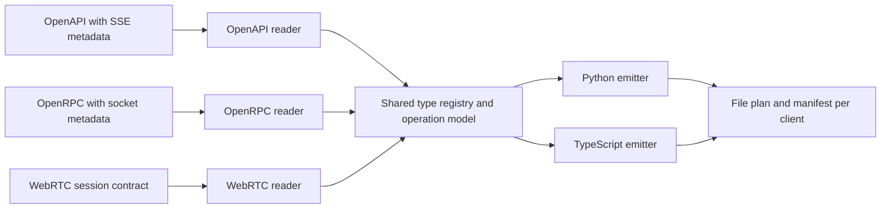

# Unified Canon package and code generation proposal

Implementation status: the prepared Canon 0.9.0 source now establishes the
single distribution, feature namespaces, dependency extras and `canon` CLI.
Existing generators are reached through `canon sse`, `canon websockets` and
`canon webrtc`. The unified configuration, shared model registry and combined
SDK described below remain planned. See the
[implemented migration](../packages/fastapi-canon/docs/package-migration.md).

Status: the package consolidation is implemented in prepared source. The shared
configuration, full generation workflow and combined SDK below remain a proposal.
Use the migration guide for currently implemented commands and APIs.

Canon becomes one distribution, `fastapi-canon`, with one version, one `canon`
command and optional feature dependencies. Public feature names describe the
transports: `sse`, `websockets` and `webrtc`. Internal modules retain ownership of
their protocol, lifecycle and validation behavior.

The single distribution and version policy is now recorded in
[AGENTS.md](../AGENTS.md). Feature guides document the implemented generators;
the remaining pipeline consolidation can proceed on top of this package layout.

## Package and feature names

| Concern | Proposed public location | Installation |
| --- | --- | --- |
| Composition, Dishka and HTTP contracts | `fastapi_canon` | `fastapi-canon` |
| Server sent events | `fastapi_canon.sse` | `fastapi-canon[sse]` |
| RPC, typed messages, raw sockets and binary streams over WebSockets | `fastapi_canon.websockets` | `fastapi-canon[websockets]` |
| WebRTC declarations, signaling and engine interfaces | `fastapi_canon.webrtc` | `fastapi-canon[webrtc]` |
| aiortc engine | `fastapi_canon.webrtc.engines.aiortc` | `fastapi-canon[webrtc,aiortc]` |
| Contract validation and client generation | `fastapi_canon.codegen` | `fastapi-canon[codegen]` |

Typical application installation:

```console
uv add fastapi-canon
uv add "fastapi-canon[sse,websockets]"
uv add --dev "fastapi-canon[codegen]"
```

These illustrate a base installation followed by adding selected features.
Code generation belongs in the development dependency group when the application
does not generate clients during production operation.

The name `websockets` identifies the transport. RPC remains a specific protocol
within it; public concepts such as `RpcService`, JSON-RPC methods, typed sockets
and raw sockets must remain distinguishable. Changing the module name does not
turn arbitrary WebSocket traffic into an RPC protocol.

Python extras select dependencies, not which source files enter the wheel. All
Canon modules ship together. Imports load optional modules and dependencies only
when needed; importing the root package or asking for CLI help must work with
the base installation.

FastAPI, Pydantic and Dishka remain base dependencies. Feature extras add only
dependencies their implementation actually needs. The existing SSE implementation
already uses FastAPI and Pydantic; `sse` may initially be an empty extra.
`websockets` can likewise be empty if its additional direct requirements are
satisfied by the base dependency declarations. Neither feature name requires
installing the Python `websockets` client library on the server. ASGI server
selection remains an application deployment choice.

The `codegen` extra contains generator dependencies such as Jinja2 and JSON Schema
validation. Generated Python SDK dependencies, such as the selected HTTP client
or WebSocket client, belong to the SDK consumer. They must not enter Canon's
server extras merely because a generated client uses them. The optional telemetry
extra remains a separate concern.

## Unified commands

The executable is `canon`, also available as `python -m fastapi_canon`.
The primary workflow is one generation command and its read-only CI form:

```console
uv run canon generate
uv run canon generate --check
uv run canon generate --check --diff
```

`generate` exports configured live contract sources, loads configured external
contracts, validates them and generates every configured client. It reports the
whole selected plan, including all stale artifacts in check mode.

Individual stages remain available for contract review and generation without
access to the server application:

| Command | Behavior |
| --- | --- |
| `canon contracts export` | Export and validate configured live contracts; validate external inputs without rewriting them. |
| `canon contracts export --check` | Compare exported contracts with committed files without writing. |
| `canon clients generate` | Generate from stored contracts, without importing application modules. |
| `canon clients generate --check` | Check SDK drift against stored contracts without writing. |
| `canon generate --target frontend` | Run the complete workflow for one named client and its contract dependencies. |
| `canon check errors src` | Expose the existing source-based HTTP error-contract checker through the same CLI. |

`--config` selects a TOML file, defaulting to `pyproject.toml` in the working
directory. Contract and generation commands share `--check` and `--diff`;
`--diff` requires `--check`. Client and full generation commands accept repeatable
`--target` selectors. Contract export accepts a corresponding `--contract`
selector. Paths and application import roots resolve relative to the config
file, with explicit imports of the form `module:attribute`.

Exit codes are consistent: `0` means success, `1` means artifact drift in check
mode, and `2` means invalid configuration, missing dependencies, invalid contracts
or an unsupported requested capability. Errors take precedence over drift.
Missing optional dependencies identify the appropriate installation extra.
Commands never install packages automatically.

## One configuration

Use one versioned `[tool.canon]` configuration. Named contracts describe sources;
named clients select contracts, transports and a target language. Transport
options remain scoped to their transport.

```toml
[tool.canon]
config-version = 1

[tool.canon.contracts.http]
kind = "openapi"
source = "app.main:app"
output = "contracts/openapi.json"

[tool.canon.contracts.websockets]
kind = "openrpc"
source = "app.contracts:websocket_contract"
output = "contracts/websockets.openrpc.json"

[tool.canon.contracts.webrtc]
kind = "webrtc"
source = "app.main:app"
output = "contracts/webrtc.json"

[tool.canon.clients.frontend]
language = "typescript"
contracts = ["http", "websockets", "webrtc"]
transports = ["sse", "websockets", "webrtc"]
output = "frontend/src/generated"
client-name = "ApiClient"

[tool.canon.clients.python]
language = "python"
contracts = ["http", "websockets"]
transports = ["sse", "websockets"]
output = "sdk/generated"
package = "application_sdk"
client-name = "ApiClient"

[tool.canon.clients.python.options.sse]
http-client = "httpx"
```

The HTTP contract contains both REST and SSE descriptions. This example selects
SSE generation; ordinary REST generation is a separate capability described
below. WebSocket contract sources are explicit `RpcContract` exports, matching
the current exporter. Discovering every RPC service from a FastAPI application
is not a prerequisite for the unified workflow.

A contract uses either `source` plus `output` for an application export, or
`input = "contracts/supplied.json"` for a supplied file. These forms are mutually
exclusive. Client-only generation reads the declared `output` or `input` file;
it never evaluates `source`. This allows a separate SDK build to install only
`fastapi-canon[codegen]` and consume contracts without the server or its feature
dependencies.

Unknown keys, duplicate destinations, overlapping generated roots, incompatible
language options and ambiguous contract selection fail before any output changes.
Every selected transport must have one compatible contract. Unsupported requested
targets fail explicitly rather than disappearing from the generated client.

## Shared generator architecture

The target pipeline is:



Each reader understands its existing contract format. A shared intermediate
representation describes reusable types, naming, documentation and operation
metadata. Separate operation variants retain HTTP responses, SSE events,
JSON-RPC calls and subscriptions, typed or raw sockets, binary streams and
WebRTC sessions. Each transport keeps its own generated runtime.

This is concrete reuse inside `fastapi_canon.codegen`; it does not require a fifth
distribution or a shared server runtime. Exported contracts remain independently
reviewable files. Their formats and existing protocol extensions are retained.

### Model identity and diagnostics

The registry provides deterministic names and consistent handling of optional
fields, nullability, aliases, enums and discriminated unions. Input validation
schemas and output serialization schemas remain distinct when their shape
differs.

Cross-contract model reuse requires a stable logical identity supplied by the
exporters or an explicit configuration binding, together with compatible schemas
and direction. A class name or matching JSON shape alone is insufficient.
External contracts without shared identity retain qualified model names unless a
binding resolves them. Conflicting schemas for one identity fail with locations
for both definitions.

Unsupported schema features produce diagnostics identifying the contract,
operation, schema path and target language. Preserve reviewed diagnostic
allowances and strict mode from the SSE generator. Do not silently widen types
to `Any` or `unknown` to hide unsupported schema semantics.

### Generated client structure

Each configured language target produces one SDK with transport-specific entry
points and a shared model module. A schematic TypeScript API is:

```typescript
const client = new ApiClient({ baseUrl });

client.sse.runs.events(...);
client.websockets.rpc.tasks.create(...);
client.websockets.sockets.telemetry.connect(...);
client.webrtc.practice.connect(...);
```

Connections and cleanup remain explicit according to each transport's lifecycle.
Constructing an SDK must not eagerly connect every transport. Shared configuration
can provide a base URL and credential providers, while individual transports
retain their supported authentication mechanisms. Browser WebSocket connections
cannot inherit arbitrary HTTP request headers.

The shared model module contains only definitions with compatible identity and
semantics. The facade and generated layout are new public client APIs and require
explicit migration steps. They do not imply identical runtime validation in both
languages: current Python clients validate supported payload models, while
TypeScript payload types do not establish full runtime schema validation.

### Output ownership and checks

One writer owns a target's `.canon-codegen.json` manifest, with the Canon version,
configuration version, target options, contract hashes and generated file list.
The manifest records SDK runtime requirements and shared model bindings. Output
is deterministic, with no timestamps or machine-specific absolute paths.

The writer removes only stale files previously recorded as generated. It rejects
unsafe paths and output collisions, preserving neighboring handwritten files.
One target cannot independently run multiple writers against the same directory.

The full workflow resolves and renders selected artifacts before writing. In
`canon generate --check`, it compares stored contracts with current exports and
compares SDK files with those same current exports held in memory. It must not
check the SDK against an already stale committed contract. Independent targets
continue to report drift when another target fails. Check mode creates no files,
including manifests and diagnostic reports; diagnostics go to command output.

## Transport and language scope

The existing implementations support the following starting scope. A shared CLI
must preserve these capabilities before introducing new ones.

| Capability | Python | TypeScript |
| --- | --- | --- |
| Typed SSE | Supported | Supported |
| WebSocket RPC and subscriptions | Supported | Supported |
| Typed JSON sockets, raw sockets and binary streams | Supported | Supported |
| WebRTC browser sessions and data channels | No existing emitter | Supported |
| Ordinary HTTP REST client generation | Separate existing tooling | Separate existing tooling |

Native REST generation is a later extension of the OpenAPI reader and emitters.
The current SSE generator emits only stream operations and reachable models;
merging packages must not be presented as already generating the entire HTTP
API. Existing REST tooling can continue in a separate owned output directory
until a native HTTP emitter is ready. Reusing models from that external tooling
requires an explicit integration.

Raw sockets expose their declared transport contract. Foreign protocols require
their existing bindings or separately supplied types; code generation cannot
infer an arbitrary native protocol from a WebSocket URL. Preserve existing
custom transport, protocol binding, Python HTTP backend and reviewed diagnostics
options under the appropriate transport or language configuration.

## Migration sequence

1. Establish the package layout, extras and single release metadata. Move public
   imports to `fastapi_canon.sse`, `fastapi_canon.websockets` and
   `fastapi_canon.webrtc`, retaining inward dependencies and lazy imports.
   Update workspace guidance as part of the actual migration.
2. Introduce the `canon` CLI and versioned configuration. Reuse existing contract
   exporters and emitters behind adapters first. During this implementation
   stage, existing emitters keep distinct owned output directories; this is not
   yet the final shared SDK.
3. Consolidate the type registry, naming, diagnostics and file planning. Adapt
   transport emitters to one SDK target and add the facade. Preserve existing
   transport capabilities and make deliberate client API changes explicit.
4. Migrate examples, consumers, artifact checks and documentation. Remove
   superseded package entry points and imports from the new Canon source instead
   of maintaining permanent parallel APIs. Previously published independent
   releases remain available for consumers staying on the earlier API.
5. Release the complete migration as the next breaking minor Canon release,
   with one package-prefixed tag, changelog and set of verified artifacts. Select
   the version against the release records at implementation time; prepared
   source versions are not evidence of publication.

Future publications use one Canon version. This eliminates internal package pin
coordination while retaining verification of optional dependency combinations.
The existing release authorization and exact-source validation requirements
continue to apply. The ordinary HTTP client emitter can follow separately.

## Completion criteria

- A fresh installed Canon wheel imports and runs its core with codegen, optional
  engines and other feature-specific dependencies absent.
- CLI help and the HTTP error checker work without installing the codegen extra.
- Offline client generation consumes saved contracts with only the base and
  codegen dependencies; it never imports the server application.
- Each feature, combined features and aiortc engine installation pass fresh-wheel
  checks with current and minimum supported dependency profiles.
- The unified workflow preserves existing wire formats, especially RPC behavior
  and `fastapi-webrtc.v1`, and the supported custom transports and bindings.
- Python and TypeScript clients execute representative SSE, RPC, typed socket,
  raw socket and binary-stream scenarios. Real browser tests cover WebRTC.
- Cross-contract models reuse compatible definitions and report identity,
  serialization-mode and naming conflicts deterministically.
- `generate --check` detects application, contract, configuration and client drift
  without modifying any output; missing contracts and unsupported targets fail
  explicitly.
- Generators preserve handwritten files, reject output collisions and pass
  generated-code lint, type, compilation and drift checks.
- Existing suites continue in separate processes until their colliding test and
  example namespaces have been reorganized.
- The breaking-change changelog documents installation, imports, configuration,
  commands and generated SDK migration before publication.
